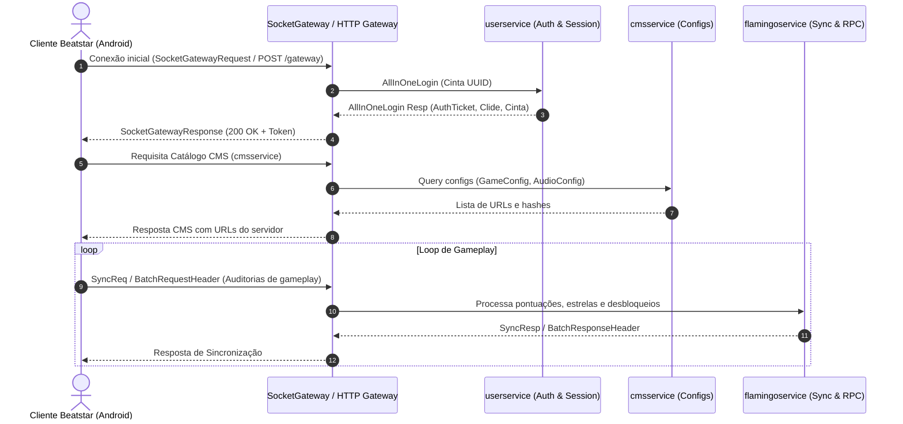

# Especificação de Protocolo: SpaceApe Sharpla & SocketGateway

- **Versão do Cliente**: `36.1.4.9545`
- **Engine**: Unity 2022.3.50f1 (IL2CPP Metadata v31)
- **Codinome do Projeto**: Flamingo

---

## 1. Topologia de Conexão



---

## 2. Enquadramento Binário (Wire Format)

O tráfego de socket utiliza prefixos de 4 bytes big-endian:

```
[4 bytes: Comprimento Total (N)]
[4 bytes: Comprimento do Cabeçalho (M)]
[M bytes: Cabeçalho Protobuf / JSON]
[N - 4 - M bytes: Corpo Protobuf / JSON (opcionalmente gzipped)]
```

### Cabeçalho de Requisição (`IClientToServerHeader`):
- `version`: String da versão do app (ex: `"36.1.4.9545"`).
- `service`: Nome do microsserviço de destino (`"userservice"`, `"cmsservice"`, `"flamingo"`).
- `rpcthing`: Identificador de correlação RPC único (`"rpc-1-123456"`).
- `authenticationTicket`: Token emitido no login.
- `clide`: ID da sessão do cliente.
- `supportsCompression`: Booleano indicando suporte a gzip.

### Cabeçalho de Resposta (`IServerToClientHeader`):
- `status`: Código HTTP / status (`200` para sucesso).
- `timestamp`: Timestamp Unix em milissegundos.
- `rpcthing`: Identificador espelhado da requisição.
- `service`: Nome do serviço executado.
- `tokenid`: Token de sessão.
- `gzipped`: Flag indicando compressão do corpo (`1` se compactado).

---

## 3. Serviços e Comandos Principais

### 3.1 `userservice`
- **Comando**: `AllInOneLogin` (`type: 7`)
- **Parâmetros**: `cinta` (UUID v4 do usuário persistido no dispositivo).
- **Resposta**: `authenticationTicket`, `clide`, `cinta`.

### 3.2 `cmsservice`
- Fornece metadados e URLs para baixar arquivos de configuração:
  - `GameConfig`: Atributos e tabelas de progressão.
  - `AudioConfig`: Parâmetros de mixagem e áudio Wwise.
  - `AssetsPatchConfig`: URLs de download de AssetBundles.
  - `LangConfig`: Arquivos de localização de idiomas.

### 3.3 `flamingoservice` / `sharplaservice`
Mais de 160 comandos de gameplay, incluindo:
- `GetCurrentUserProfile_Req` / `GetCurrentUserProfile_Resp`
- `SyncReq` / `SyncResp`
- `RhythmGameStarted_SharplaAudit`
- `RhythmGameEnded_SharplaAudit`
- `SelectFtueStarterSong_SharplaAudit`
- `JoinShowdown_SharplaRpcReq` / `JoinShowdown_SharplaRpcResp`
- `Leaderboard_Req` / `Leaderboard_Resp`
